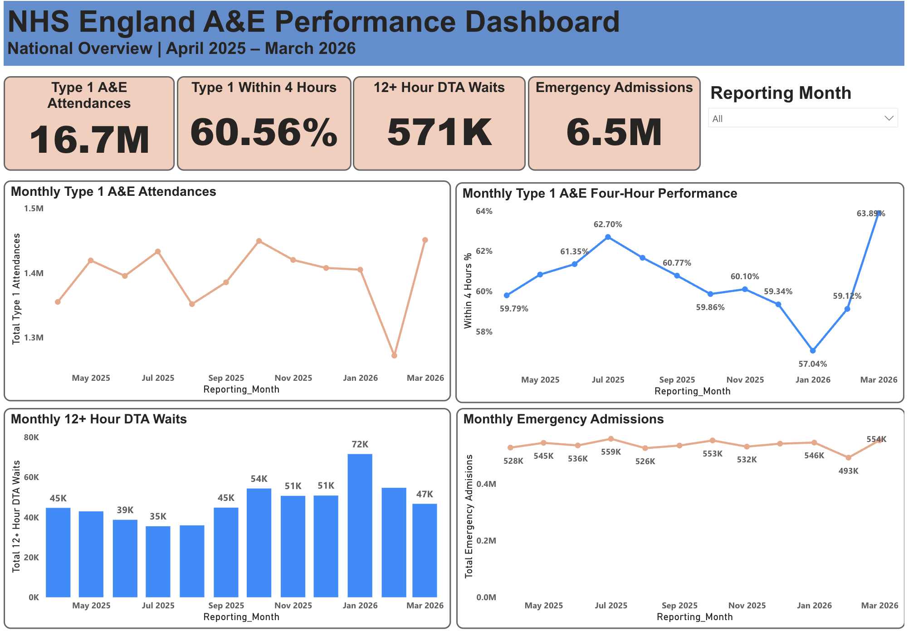
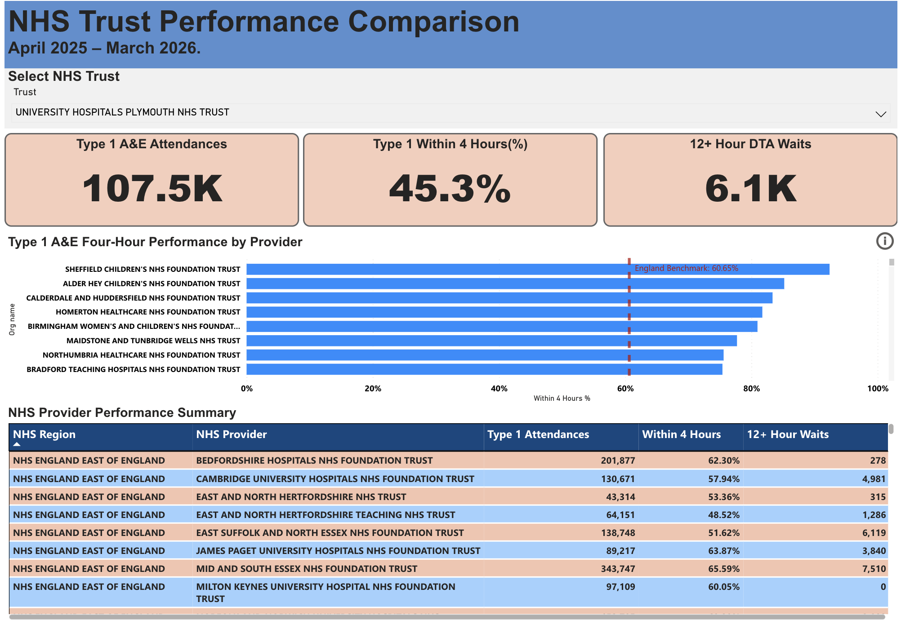
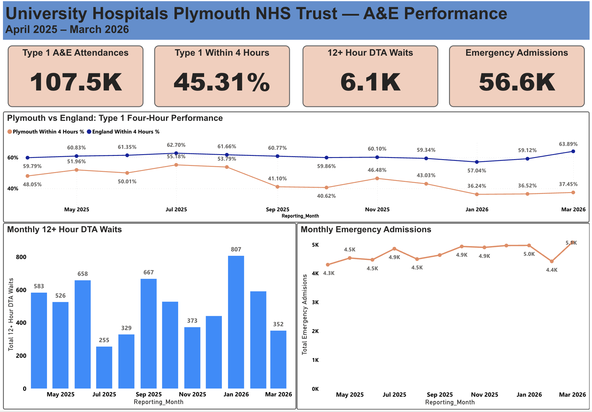

# NHS England A&E Performance Analysis

### SQL Server | Power BI | Healthcare Analytics | April 2025 – March 2026

An end-to-end healthcare data analytics project examining Accident & Emergency (A&E) performance across NHS England, with a detailed case study of **University Hospitals Plymouth NHS Trust**.

The project uses official NHS England monthly A&E activity data, SQL Server for data exploration and analysis, and Power BI to develop an interactive three-page dashboard.

The analysis focuses on **Type 1 A&E attendances, four-hour performance, prolonged waiting times following the decision to admit, emergency admissions, and differences between NHS providers**.

## Dashboard Preview

### Page 1 — NHS England Overview

### Page 2 — NHS Trust Performance Comparison

### Page 3 — University Hospitals Plymouth NHS Trust

---

## 1. Project Overview

Accident & Emergency departments play a critical role in delivering urgent and emergency healthcare services across England.

Monitoring A&E attendances, waiting times and emergency admissions helps identify patterns in service demand and differences in operational performance.

This project analyses NHS England A&E activity between **April 2025 and March 2026**, combining national-level reporting with a focused assessment of University Hospitals Plymouth NHS Trust.

### Project Objectives

- Examine monthly Type 1 A&E attendance trends across NHS England.
- Calculate the proportion of Type 1 attendances completed within four hours.
- Analyse prolonged waits of 12 hours or more following a decision to admit.
- Examine monthly emergency admission volumes.
- Compare four-hour performance across NHS providers.
- Evaluate University Hospitals Plymouth NHS Trust against the England benchmark.
- Develop an interactive Power BI dashboard to communicate findings.

## 2. Data Source

**Dataset:** A&E Attendances and Emergency Admissions — Monthly Statistics

**Publisher:** NHS England

**Source:** [NHS England — A&E Attendances and Emergency Admissions](https://www.england.nhs.uk/statistics/statistical-work-areas/ae-waiting-times-and-activity/)

**Reporting Period:** April 2025 – March 2026

The project uses publicly available, provider-level monthly statistics published by NHS England.

Twelve monthly datasets were combined to create a consolidated analytical dataset containing:

| Dataset Characteristic | Value |
|---|---:|
| Reporting Period | April 2025 – March 2026 |
| Months Analysed | 12 |
| Dataset Records | 2,386 |
| Distinct NHS Provider Codes | 205 |
| Focus NHS Trust | University Hospitals Plymouth NHS Trust |
| Focus Trust Code | RK9 |

The data contains aggregated provider-level activity rather than individual patient records.

## 3. Tools and Technologies

| Tool | Application |
|---|---|
| Microsoft SQL Server | Data exploration, aggregation and performance analysis |
| SQL | Filtering, grouping, calculations and comparative analysis |
| Microsoft Excel | Combining and preparing monthly NHS datasets |
| Power Query | Importing, cleaning and consolidating monthly files |
| Power BI Desktop | Developing interactive dashboards and visualisations |
| DAX | Creating calculated performance measures and KPIs |
| GitHub | Project documentation and portfolio presentation |

## 4. Data Preparation and Validation

### Data Consolidation

Twelve monthly NHS England A&E datasets covering April 2025 to March 2026 were downloaded and consolidated using Excel Power Query.

The combined dataset was prepared for SQL Server analysis and Power BI reporting.

### Data Cleaning

Data preparation included:

- Combining the twelve monthly datasets into a single table.
- Standardising reporting-month information.
- Checking numeric fields used in attendance and waiting-time calculations.
- Excluding national `TOTAL` summary rows to prevent double counting.
- Checking for duplicate provider-month records.
- Verifying the reporting period and provider coverage.

### Data Validation

The final dataset contained **2,386 provider-month records covering 205 distinct provider codes**.

Additional checks were performed to verify the accuracy of attendance totals, four-hour performance calculations, emergency admissions and prolonged waiting-time measures.

The SQL analysis was performed using the table `[dbo].[NHS_AE_Data]`.

Power BI was connected to the prepared Excel dataset, with DAX measures used to calculate performance indicators.

## 5. Key Performance Indicators

### NHS England — April 2025 to March 2026

| KPI | Value |
|---|---:|
| Total Type 1 A&E Attendances | 16,744,864 |
| Type 1 Attendances Over Four Hours | 6,604,765 |
| Type 1 Attendances Within Four Hours | 60.56% |
| Patients Waiting 12+ Hours Following DTA | Approximately 571,000 |
| Total Emergency Admissions | Approximately 6.5 million |

### University Hospitals Plymouth NHS Trust

| KPI | Value |
|---|---:|
| Total Type 1 A&E Attendances | 107,510 |
| Type 1 Attendances Within Four Hours | 45.31% |
| Patients Waiting 12+ Hours Following DTA | 6,110 |
| Total Emergency Admissions | 56,568 |

The four-hour performance indicator represents the percentage of recorded Type 1 A&E attendances not classified as exceeding four hours. It is a Type 1-specific measure rather than the overall NHS A&E four-hour standard.

**DTA** refers to the *decision to admit*. DTA waiting times measure delays following that decision, rather than total time spent in A&E from arrival.

## 6. SQL Analysis and Power BI Dashboard

### 6.1 SQL Analysis

SQL Server was used to investigate A&E activity and performance at national and NHS Trust levels.

The analysis covered:

**1. Data Coverage and Reporting Completeness**

Verified the reporting period, available records and monthly coverage for University Hospitals Plymouth NHS Trust.

**2. Monthly Type 1 A&E Attendances**

Examined monthly attendance volumes to understand changes in emergency department activity.

**3. Type 1 Four-Hour Performance**

Calculated the percentage of Type 1 attendances completed within four hours using attendance and over-four-hour counts.

**4. England-Level Performance**

Aggregated provider-level activity to calculate national attendance volumes and weighted four-hour performance.

**5. England vs Plymouth Comparison**

Compared Plymouth's monthly Type 1 four-hour performance with the corresponding England percentage.

**6. Prolonged DTA Waiting Times**

Examined patients waiting 4–12 hours and 12 hours or more following the decision to admit.

**7. Emergency Admissions**

Analysed monthly emergency admissions and their distribution across reported admission categories.

**8. Emergency Admission Ratio**

Examined the relationship between Type 1 emergency admissions and Type 1 A&E attendances.

**9. Admission Ratio and Four-Hour Performance**

Compared monthly emergency admission ratios with four-hour performance to explore possible patterns in hospital activity.

The SQL queries used in this project are available in [NHS_AE_Data_Anaysis.sql](NHS_AE_Data_Anaysis.sql).

### 6.2 Power BI Dashboard — Page 1: NHS England Overview

The first dashboard page provides a national overview of A&E activity and performance.

It includes four KPI cards displaying Type 1 attendances, four-hour performance, 12+ hour DTA waits and total emergency admissions.

Four additional visualisations examine:

- Monthly Type 1 A&E attendances.
- Monthly Type 1 four-hour performance.
- Monthly 12+ hour DTA waiting volumes.
- Monthly emergency admissions.

This page provides a summary of national emergency care activity and changes in performance over the reporting period.

### 6.3 Power BI Dashboard — Page 2: NHS Trust Comparison

The second dashboard page enables comparisons between NHS providers.

It includes:

- An interactive NHS Trust selection slicer.
- KPI cards showing the selected provider's activity and performance.
- A provider comparison chart displaying Type 1 four-hour performance.
- An England benchmark reference line.
- A comparison table containing NHS providers, regional groupings, attendance volumes, four-hour performance and 12+ hour DTA waits.

This page allows users to examine differences between NHS providers and compare their performance against the national benchmark.

### 6.4 Power BI Dashboard — Page 3: Plymouth NHS Trust

The third dashboard page focuses on **University Hospitals Plymouth NHS Trust (RK9)**.

It presents:

- Total Type 1 A&E attendances.
- Type 1 four-hour performance.
- Total 12+ hour DTA waits.
- Total emergency admissions.
- Monthly Plymouth versus England four-hour performance.
- Monthly 12+ hour DTA waiting volumes.
- Monthly emergency admission trends.

The England comparison measure uses DAX to remove the selected provider filter while preserving the reporting-month context.

This allows Plymouth's performance to be compared against the corresponding national percentage throughout the reporting period.

## 7. Key Findings and Insights

### 7.1 National A&E Activity

Across the reporting period, NHS England recorded approximately **16.7 million Type 1 A&E attendances**.

Of these, approximately **6.6 million exceeded four hours**, resulting in an overall Type 1 four-hour performance of **60.56%**.

National monthly performance varied across the year.

The highest monthly percentage was recorded in **March 2026 (63.89%)**, while the lowest occurred in **January 2026 (57.04%)**.

These findings demonstrate variation in emergency department performance over time.

### 7.2 Plymouth Performed Below the England Benchmark

University Hospitals Plymouth NHS Trust recorded **107,510 Type 1 attendances**, with an overall four-hour performance of **45.31%**.

This was approximately **15.25 percentage points below** the England figure of 60.56%.

Plymouth's monthly four-hour performance was below the England benchmark in every month of the reporting period.

The smallest monthly difference occurred in **July 2025**, when Plymouth was **7.52 percentage points** below England.

The largest difference occurred in **March 2026**, when the gap reached **26.44 percentage points**.

This indicates a persistent performance difference between Plymouth and the national aggregate during the period analysed.

### 7.3 Plymouth's Four-Hour Performance Declined

Plymouth's strongest monthly four-hour performance was recorded in **July 2025 (55.18%)**.

Performance subsequently declined, reaching **36.24% in January 2026**.

By March 2026, the percentage was **37.45%**, remaining substantially below the England figure of 63.89%.

This highlights a deterioration in Plymouth's recorded Type 1 four-hour performance during the latter part of the reporting period.

### 7.4 Prolonged Waiting Times Following Decision to Admit

Across NHS England, approximately **571,000 patients** were recorded as waiting 12 hours or more following a decision to admit.

University Hospitals Plymouth NHS Trust recorded **6,110 such waits** during the reporting period.

Plymouth's highest monthly 12+ hour DTA waiting volume occurred in **January 2026**, with **807 patients**.

This coincided with Plymouth's lowest monthly Type 1 four-hour performance.

Although both indicators suggest pressure on emergency care services, the analysis does not establish a causal relationship between them.

### 7.5 Emergency Admissions

NHS England recorded approximately **6.5 million emergency admissions** during the reporting period.

University Hospitals Plymouth NHS Trust recorded **56,568 emergency admissions**.

Plymouth's monthly emergency admission volumes fluctuated across the year, with the highest monthly total recorded in **March 2026 (5,076 admissions)**.

These figures provide additional context for understanding emergency care activity alongside attendance volumes and waiting-time performance.

### 7.6 NHS Provider Comparisons

The provider comparison dashboard revealed variation in Type 1 four-hour performance across NHS organisations.

The national benchmark enables individual providers to be compared with England's aggregated performance.

However, differences in patient populations, hospital services, case mix and operational arrangements should be considered when interpreting provider-level comparisons.

## 8. Limitations

- **Aggregated data:** The dataset contains provider-level monthly totals rather than individual patient records.
- **Performance definition:** The calculated four-hour indicator covers Type 1 A&E attendances only and is not the overall NHS A&E four-hour measure.
- **Provider comparisons:** Differences in hospital size, patient complexity and service provision may affect performance comparisons.
- **Descriptive analysis:** The findings identify trends and differences but do not establish their underlying causes.

---

**Project Focus:** Healthcare Data Analytics | NHS Performance Reporting | SQL Server | Power BI | DAX
